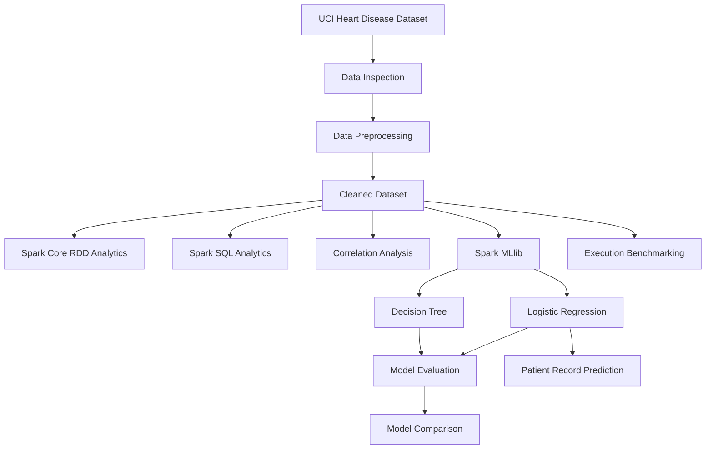

# Distributed Healthcare Analytics & Heart Disease Prediction Using Apache Spark

<p align="center">
  
  
  
  
  
  
</p>

<p align="center">
  <b>An end-to-end healthcare analytics and machine learning project powered by Apache Spark and PySpark.</b>
  <br>
  Exploring distributed data processing, healthcare insights, predictive modelling, and performance benchmarking through a terminal-based application.
</p>

---

## 1. Overview

Healthcare datasets contain valuable information that can help identify patterns and relationships associated with different medical conditions. Processing and analysing such data requires effective data management, statistical analysis, and predictive modelling techniques.

This project, **Distributed Healthcare Analytics and Heart Disease Prediction Using Apache Spark and PySpark**, demonstrates an end-to-end data processing and machine learning workflow using the UCI Heart Disease dataset.

Developed as part of the INT315 Cluster Computing project, it integrates Apache Spark's core components to perform data inspection, preprocessing, RDD operations, SQL-based analytics, correlation analysis, machine learning, model evaluation, and execution benchmarking.

The application also provides an interactive command-line interface for entering patient records and obtaining predictions from a trained Logistic Regression model.

**Key highlights:**
- End-to-end data processing using PySpark.
- Missing-value handling through median imputation.
- Spark Core RDD transformations and actions.
- Healthcare analytics using Spark SQL.
- Machine learning using Spark MLlib.
- Logistic Regression and Decision Tree comparison.
- Correlation analysis and partition benchmarking.
- Interactive terminal-based prediction.

> **Disclaimer:** This project is intended strictly for academic and educational purposes. Its predictions are not medical diagnoses and must not be used for clinical decision-making.

## 2. Problem Statement

Heart disease analysis involves examining multiple patient attributes, including age, blood pressure, cholesterol, chest pain characteristics, and other clinical measurements.

The objective of this project is to develop a Spark-based analytical system that processes healthcare records, extracts meaningful statistical insights, and applies machine learning classification algorithms to identify patterns associated with the presence or absence of heart disease.

The project also demonstrates how Apache Spark's processing capabilities can be used to structure an end-to-end analytical workflow.

## 3. Project Objectives

1. Inspect the healthcare dataset, including its schema, dimensions, and missing values.
2. Clean and preprocess the dataset using median imputation.
3. Demonstrate Spark Core RDD transformations, actions, and partition operations.
4. Perform healthcare data analysis using Spark SQL.
5. Implement Logistic Regression and Decision Tree classifiers using Spark MLlib.
6. Evaluate model performance using classification metrics.
7. Analyse correlations between numerical features and the target variable.
8. Benchmark execution time under different partition configurations.
9. Implement an interactive patient-record prediction module.
10. Compare machine learning models and identify the better-performing model on the evaluation split.

## 4. Technology Stack

| Technology | Version / Purpose |
|---|---|
| Python | 3.11.9 |
| Apache Spark | 3.5.3 |
| PySpark | 3.5.3 |
| Java JDK | 21 |
| Spark Core | RDD processing |
| Spark SQL | Data analytics and queries |
| Spark MLlib | Machine learning |
| NumPy / Pandas | Data handling and numerical operations |
| Windows CMD | Project execution environment |

## 5. Dataset Information

**Dataset:** UCI Machine Learning Repository – Heart Disease (Processed Cleveland Dataset)

**Source:** [UCI Heart Disease Dataset](https://archive.ics.uci.edu/dataset/45/heart+disease)

The project uses the processed Cleveland heart disease dataset.

| Dataset property | Value |
|---|---|
| Total records | 303 |
| Original features | 13 |
| Original columns | 14 |
| Target column | `num` |
| Classification type | Binary classification |
| Missing values | Present in original dataset |

### Target Variable Transformation

The original `num` column contains five possible values (0–4). For binary classification, it is transformed into:

- `0` – No heart disease (`num = 0`)
- `1` – Heart disease present (`num > 0`)

### Original Class Distribution

| Class | Records |
|---|---:|
| No heart disease | 164 |
| Heart disease present | 139 |
| **Total** | **303** |

The original dataset contains missing values represented by `?`. These are handled during preprocessing.

The cleaned dataset contains 303 records, 15 columns, and no remaining missing values.

## 6. System Architecture and Workflow

The project follows a modular architecture in which each processing stage is implemented independently and integrated through a central terminal-based application.

### Processing Workflow



### Main Processing Stages

1. **Data ingestion:** Load the original Cleveland dataset into Spark.
2. **Data inspection:** Examine records, schema, data types, and missing values.
3. **Preprocessing:** Handle missing feature values and transform the target variable.
4. **Distributed analytics:** Perform RDD-based operations and Spark SQL queries.
5. **Machine learning:** Train Logistic Regression and Decision Tree classifiers.
6. **Evaluation:** Compare classification metrics and ROC-AUC.
7. **Benchmarking:** Examine execution time under different partition configurations.
8. **Prediction:** Accept patient information through the terminal and generate a model prediction.

## 7. Project Structure

```text
INT315_Healthcare_Spark/
│
├── data/
│   ├── processed.cleveland.data
│   └── heart_disease_clean.csv/
│
├── models/
│   ├── logistic_regression_pipeline/
│   └── decision_tree_pipeline/
│
├── outputs/
│   ├── model_comparison.csv
│   ├── correlation_matrix.csv
│   └── spark_benchmark.csv
│
├── src/
│   ├── main.py
│   ├── inspect_data.py
│   ├── preprocessing.py
│   ├── rdd_analytics.py
│   ├── sql_analytics.py
│   ├── train_logistic_regression.py
│   ├── train_decision_tree.py
│   ├── compare_models.py
│   ├── correlation_analysis.py
│   ├── benchmark_spark.py
│   └── predict_patient.py
│
├── .gitignore
├── requirements.txt
└── README.md
```

*Note: Generated datasets, model directories, and output files are created when the corresponding project modules are executed. The structure above represents the intended project organization.*

Spark CSV output is stored as a directory containing part files and a `_SUCCESS` marker rather than necessarily as a single CSV file.

## 8. Installation and Configuration

### Prerequisites

Install the following software:

- Python 3.11
- Java JDK 21
- Apache Spark 3.5.3
- Git (optional, for version control)

Ensure Java and Spark are configured correctly in the Windows environment.

### Step 1: Clone the Repository

Open Windows Command Prompt:

```cmd
git clone https://github.com/Priyanshu2835/Spark-Heart-Disease-Prediction.git
```

Navigate to the project directory:

```cmd
cd Spark-Heart-Disease-Prediction
```

### Step 2: Install Dependencies

```cmd
py -3.11 -m pip install -r requirements.txt
```

Verify PySpark installation:

```cmd
py -3.11 -m pip show pyspark
```

### Step 3: Verify Java

```cmd
java -version
```

Verify Spark configuration:

```cmd
echo %JAVA_HOME%
echo %SPARK_HOME%
```

Ensure `JAVA_HOME` points to your JDK installation and `SPARK_HOME` points to your Spark installation.

## 9. Running the Project

The project is designed to run through Windows Command Prompt using a menu-driven terminal interface. No web application or graphical interface is required.

Navigate to the project directory:

```cmd
cd /d D:\INT315_Healthcare_Spark
```

Launch the application:

```cmd
py -3.11 src\main.py
```

### Application Menu

| Option | Functionality |
|---|---|
| 1 | Dataset inspection |
| 2 | Data preprocessing |
| 3 | RDD operations and partition analysis |
| 4 | Spark SQL healthcare analytics |
| 5 | Train Logistic Regression |
| 6 | Train Decision Tree |
| 7 | Compare model performance |
| 8 | Correlation analysis |
| 9 | Spark execution benchmarking |
| 10 | Patient record prediction |
| 0 | Exit application |

**Recommended execution sequence:**

1. Inspect the original dataset.
2. Run data preprocessing.
3. Execute RDD analytics.
4. Execute Spark SQL analytics.
5. Perform correlation analysis.
6. Train Logistic Regression.
7. Train Decision Tree.
8. Compare model performance.
9. Run execution benchmarking.
10. Perform patient-record prediction after training the Logistic Regression model.

## 10. Implementation Details

### 10.1 Data Inspection and Preprocessing

The inspection module examines:
- Dataset dimensions and schema.
- Data types and sample records.
- Missing-value counts.
- Original target distribution.

The preprocessing module:
- Handles missing feature values using median imputation.
- Converts the original target into binary classification labels.
- Produces a cleaned dataset for subsequent analysis and model training.

### 10.2 Spark Core RDD Analytics

This module demonstrates fundamental distributed data processing operations using Resilient Distributed Datasets (RDDs).

Operations include:
- `map()`
- `filter()`
- `reduce()`
- `count()`
- `collect()`
- Key-based aggregation.
- Partition analysis.

**Verified analytical results:**

| Analysis | Result |
|---|---:|
| Total records | 303 |
| Patients aged 60 or above | 91 |
| Average age | 54.44 years |
| Number of partitions | 2 |
| Partition distribution | 151 and 152 records |

### 10.3 Spark SQL Healthcare Analytics

Spark SQL is used to perform structured queries and aggregate healthcare statistics.

Analytical operations include:
- Average age.
- Average cholesterol.
- Average resting blood pressure.
- Disease-class distribution.
- Age-group analysis.
- Comparisons between disease and non-disease groups.

**Verified aggregate results:**

| Metric | Average |
|---|---:|
| Age | 54.44 |
| Cholesterol | 246.69 |
| Resting blood pressure | 131.69 |

### 10.4 Machine Learning Using Spark MLlib

Two classification algorithms are implemented using Spark MLlib.

**Logistic Regression**

A supervised classification algorithm used to estimate the probability of a binary outcome.

**Decision Tree**

A tree-based classification algorithm that makes predictions through a sequence of feature-based decision rules.

Both pipelines incorporate categorical feature indexing, one-hot encoding, feature assembly, and model training.

An 80:20 seeded random train-test split is used for evaluation.

### 10.5 Correlation Analysis

Pearson correlation is used to examine linear relationships between selected numerical features and the binary target variable.

This helps identify statistical associations within the dataset.

Correlation does not establish causation.

### 10.6 Spark Execution Benchmarking

The benchmarking module evaluates the execution time of a healthcare aggregation under different partition configurations.

The objective is to demonstrate how partitioning can affect Spark execution.

Benchmark results are dependent on local machine resources, Spark startup overhead, caching, and execution conditions.

### 10.7 Interactive Patient Prediction

The prediction module provides a terminal-based interface that accepts patient feature values from the user.

The trained Logistic Regression pipeline is loaded to generate:
- Predicted classification.
- Probability associated with class 0.
- Probability associated with class 1.

The output is an educational model prediction and not a medically validated individual risk estimate.

## 11. Model Performance and Results

Both classification algorithms were evaluated using the same recorded seeded train-test split.

### Performance Comparison

| Evaluation Metric | Logistic Regression | Decision Tree |
|---|---:|---:|
| Accuracy | **85.11%** | 70.21% |
| Weighted Precision | **85.42%** | 70.02% |
| Weighted Recall | **85.11%** | 70.21% |
| Weighted F1-score | **84.89%** | 69.59% |
| ROC-AUC | **91.11%** | 56.48% |

### Model Evaluation Summary

**Logistic Regression** achieved better performance across all recorded evaluation metrics.

Key observations:

- Accuracy of 85.11%.
- Weighted F1-score of 84.89%.
- ROC-AUC of 0.9111.
- Better class discrimination on the recorded test split compared with the Decision Tree model.

The Decision Tree achieved an accuracy of 70.21% and ROC-AUC of 0.5648.

Based on this evaluation, Logistic Regression is the better-performing model for this experiment.

**Evaluation details:**

- Training records: 256
- Testing records: 47
- Random seed: 42
- Train-test ratio: 80:20

The test set is relatively small and the split is not stratified. Therefore, these results should be interpreted cautiously and do not establish generalization or clinical validity.

## 12. Sample Prediction

The interactive prediction module was tested using a sample patient record.

**Observed output:**

```text
Predicted Class: 1

Class 0 Probability: 0.0946
Class 1 Probability: 0.9054
```

**Interpretation:**

The model classified the entered sample record as class 1, representing the presence of heart disease in the dataset's binary target encoding.

The probabilities represent the model's output for that particular input. They are not clinically calibrated probabilities or validated estimates of an individual's medical risk.

## 13. Limitations

Despite demonstrating an end-to-end Spark analytics workflow, the project has several limitations:

1. The dataset contains only 303 records.
2. The test set contains only 47 records.
3. The train-test split is not stratified.
4. Model performance may vary with different random splits.
5. Local benchmarking results may be influenced by system resources and execution overhead.
6. The implementation was tested in a local Windows environment rather than a multi-node production cluster.
7. The trained models have not undergone external clinical validation.
8. The prediction system must not be used for actual medical diagnosis or treatment decisions.

## 14. Future Enhancements

Potential improvements include:

- Evaluating models using stratified cross-validation.
- Testing additional classification algorithms.
- Applying hyperparameter tuning.
- Evaluating performance on larger healthcare datasets.
- Implementing feature importance and explainability analysis.
- Testing Spark applications on a multi-node cluster.
- Improving benchmark reliability through repeated measurements.
- Performing external validation using independent datasets.

## 15. Conclusion

This project demonstrates the application of Apache Spark and PySpark in healthcare data processing, analytical computation, and machine learning.

It integrates Spark Core RDD operations, Spark SQL, Spark MLlib, correlation analysis, execution benchmarking, and interactive terminal-based prediction into a single modular application.

The experimental results indicate that Logistic Regression outperformed Decision Tree on the recorded evaluation split, achieving 85.11% accuracy and 0.9111 ROC-AUC.

Overall, the project provides practical experience in big data processing concepts, distributed computing APIs, healthcare analytics, and machine learning workflows using Apache Spark.

## 16. References

1. **UCI Machine Learning Repository:** Heart Disease Dataset  
   https://archive.ics.uci.edu/dataset/45/heart+disease

2. **Apache Spark Documentation:** Version 3.5.3  
   https://spark.apache.org/docs/3.5.3/

3. **PySpark Documentation:**  
   https://spark.apache.org/docs/3.5.3/api/python/

4. **Apache Spark MLlib:**  
   https://spark.apache.org/docs/3.5.3/ml-guide.html

---

## Author

**Priyanshu Kumar**

B.Tech – Computer Science and Engineering

Specialization: Data Science

- GitHub: [@Priyanshu2835](https://github.com/Priyanshu2835)
- Project Repository: [Spark-Heart-Disease-Prediction](https://github.com/Priyanshu2835/Spark-Heart-Disease-Prediction)

---

<p align="center">
  <b>Built with Python, Apache Spark, PySpark and Machine Learning.</b>
  <br>
  <i>Academic Project – INT315 Cluster Computing</i>
</p>